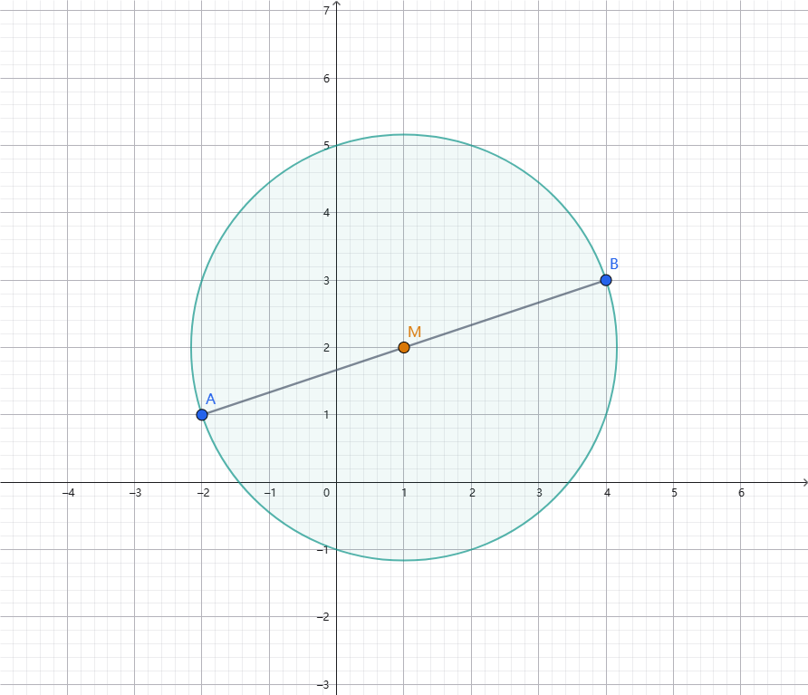

# 第 1 周 · 线段、中点和圆

A、B 是自由点，M 是线段 AB 的中点。圆以 M 为圆心，经过 A 和 B。[GeoGebra 源文件](../../01-GeoGebra/第01周/第1周-基础对象.ggb) · [周笔记](../../05-过程记录/每周笔记/第01周.md)

## 初始构造

## 拖动端点

| 操作 | 中点 M | 界面截图 |
| --- | --- | --- |
| 初始状态 | (1,2) | [初始界面](图片/week01-initial.png) |
| A 拖到 (-3,2) | (0.5,2.5) | [拖动 A](图片/week01-drag-A.png) |
| B 再拖到 (3,-1) | (0,0.5) | [拖动 B](图片/week01-drag-B.png) |

[从磁盘重开](图片/week01-disk-open.png) · [重开后拖动 A](图片/week01-disk-drag.png)
