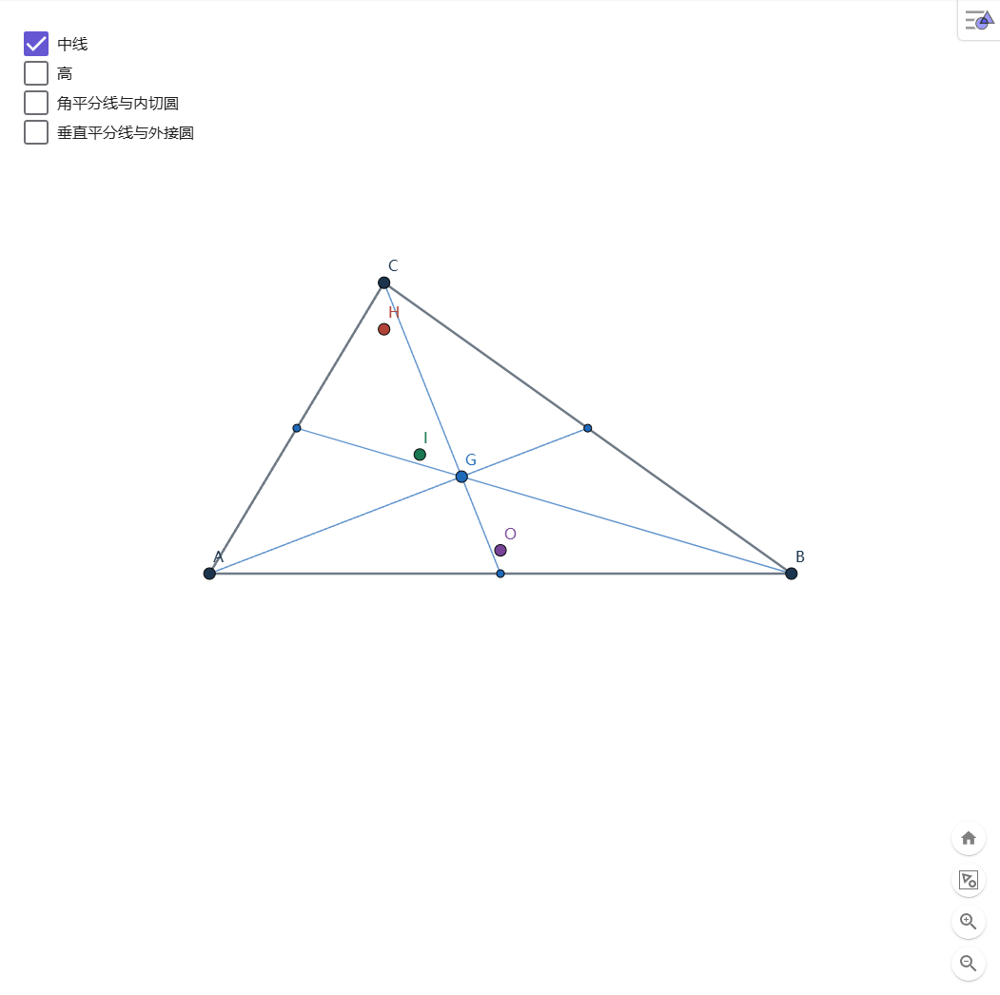

# 三角形四心展示

[打开 .ggb](../../01-GeoGebra/第02周/第2周-三角形四心.ggb) · [对象依赖表和周记](../../05-过程记录/每周笔记/第02周.md)

打开文件后，蓝色 G 是重心，红色 H 是垂心，绿色 I 是内心，紫色 O 是外心。左上角每个复选框控制一组辅助线。下图显示三条中线。

| 看哪一种构造 | 对应图片 |
| --- | --- |
| 过三个顶点作对边的垂线 | [三条高](图片/week02-altitudes.png) |
| 内心到三条边的距离相等 | [角平分线与内切圆](图片/week02-angle-bisectors.png) |
| 外心到三个顶点的距离相等 | [垂直平分线与外接圆](图片/week02-perpendicular-bisectors.png) |
| 把 C 拖到 A 的左上方 | [钝角三角形，垂心在外](图片/week02-obtuse-drag.png) |
| 把 AC 设为垂直于 AB | [直角三角形，垂心在 A，外心在斜边中点](图片/week02-right.png) |
